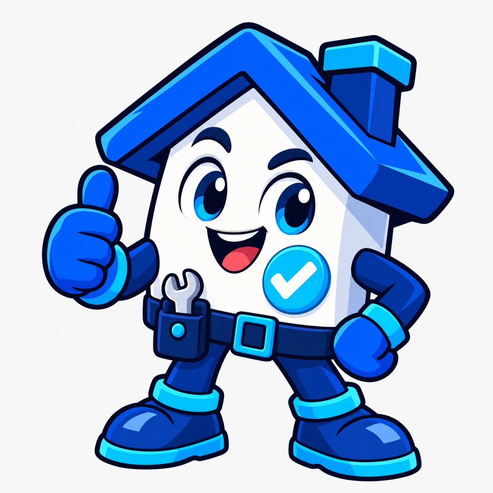

<p align="center">
  
</p>

<h1 align="center">Quicko</h1>

<p align="center"><b>Servicios para el hogar, más fáciles de encontrar.</b></p>

<p align="center">
  
</p>

<p align="center">
  Plataforma que conecta a personas que necesitan un servicio a domicilio con trabajadores independientes cercanos, verificados y con calificaciones visibles.
</p>

<p align="center">
  
  
  
</p>

---

## 📌 Descripción

Quicko es una propuesta de plataforma web y móvil para resolver de forma rápida y confiable pequeños inconvenientes del hogar: daños de plomería, cerraduras averiadas, fallas eléctricas o reparación de electrodomésticos.

## ❗ Problema

- Encontrar un trabajador de confianza depende del voz a voz o de directorios poco confiables.
- Los trabajadores independientes no tienen una vitrina digital donde mostrar su experiencia y reputación.
- El resultado es pérdida de tiempo, desconfianza e inseguridad para los clientes.

## ✅ Solución

Quicko centraliza la información de los trabajadores, permite buscarlos por categoría y consultar su calificación antes de contratar.

## ✨ Funcionalidades

- Registro de clientes y trabajadores
- Verificación de identidad del trabajador (CC/CE, foto de perfil y comprobante de domicilio)
- Gestión de categorías de servicio
- Búsqueda de trabajadores por categoría
- Gestión de solicitudes de servicio
- Calificación del trabajador de 1 a 5 al finalizar el servicio
- Consulta de la calificación promedio de cada trabajador

## 🔄 Cómo funciona

1. **Registro:** el cliente o el trabajador crea su cuenta.
2. **Búsqueda:** el cliente elige la categoría del servicio que necesita.
3. **Consulta:** ve los trabajadores disponibles y sus calificaciones.
4. **Solicitud:** selecciona un trabajador y envía su solicitud.
5. **Servicio:** el trabajador acepta y atiende la solicitud.
6. **Calificación:** el cliente califica al trabajador de 1 a 5.

## 👥 Modos de uso

| Modo | Para quién | Qué permite |
|------|-----------|-------------|
| **Usuario** | Quien necesita un servicio | Solicitar servicios por categoría y consultar calificaciones |
| **Trabajador** | Quien ofrece sus servicios | Registrarse, verificar su identidad y gestionar solicitudes |

## 🛠️ Servicios

Plomería · Cerrajería · Electricidad · Reparación de electrodomésticos · Servicio doméstico · Pintura · Jardinería · Carpintería

> Las categorías son ejemplos de orientación del proyecto y se pueden ampliar.

## 🗄️ Base de datos

Se utiliza una base de datos relacional **MySQL**.

| Entidad | Descripción |
|---------|-------------|
| `Cliente` | Datos personales, localidad y dirección |
| `Trabajador` | Datos personales, tipo y número de documento (CC/CE), experiencia y disponibilidad |
| `Categoria` | Nombre y descripción del servicio |
| `TrabajadorCategoria` | Tabla intermedia que relaciona trabajadores con las categorías que ofrecen |
| `Solicitud` | Cliente, trabajador, categoría, descripción del problema, fechas y estado |
| `Calificacion` | Puntuación, comentario y fecha, asociada a una solicitud |

**Estados de una solicitud:** `Pendiente` · `Aceptada` · `Rechazada` · `Finalizada` · `Cancelada`

## 📋 Requerimientos no funcionales

- Validación de mayoría de edad de los trabajadores mediante CC/CE
- Seguridad en el manejo de datos personales
- Usabilidad intuitiva para clientes de distintas edades
- Escalabilidad para agregar nuevas categorías de servicio

## 🎨 Identidad visual

| Color | Código | Uso |
|-------|--------|-----|
|  | `#1347E5` | Azul principal: botones y elementos de acción |
|  | `#0B2A8F` | Azul oscuro: títulos y logo |
|  | `#1FC4EE` | Cian: detalles y acentos |
|  | `#E8F0FF` | Azul claro: fondos de secciones |
|  | `#10224F` | Azul noche: texto |

<p align="center">
  
  &nbsp;&nbsp;&nbsp;
  
</p>

## 🧪 Diseño y usabilidad

La interfaz fue evaluada con las 10 heurísticas de usabilidad de Nielsen. Los mockups incluyen el registro del trabajador, el perfil del trabajador, la guía "¿Cómo funciona la solicitud?" y la pantalla principal del usuario.

## 💻 Tecnologías

- **Base de datos:** MySQL
- **Frontend:** _completar_
- **Backend:** _completar_

## 🚀 Instalación

```bash
# 1. Clonar el repositorio
git clone https://github.com/TU-USUARIO/quicko.git

# 2. Entrar a la carpeta del proyecto
cd quicko

# 3. Importar la base de datos en MySQL (completar con el nombre de tu archivo)
mysql -u root -p < database/quicko.sql
```

## 📍 Estado del proyecto

🚧 En desarrollo. El alcance y las funciones podrán ajustarse conforme avance el proyecto.

## 👨‍💻 Equipo

- Juan Sebastián Carvajal Rojas
- Javier Steven Ariza Peñuela
- Juan Daniel Polanco Barrera
- Andrés Camilo Campos Osorio
